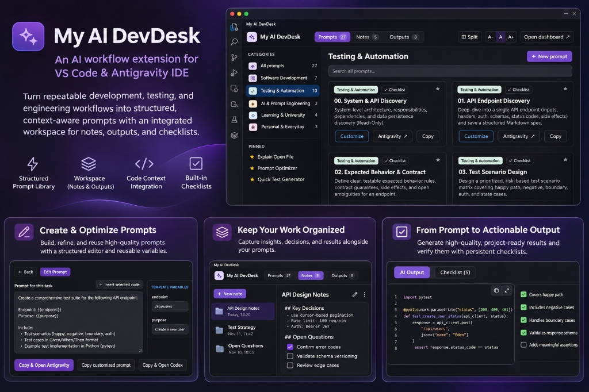

# My AI DevDesk ✨

*(formerly Eden's Prompt Hub)*

A zero-dependency **Antigravity IDE** & **VS Code** companion workspace for AI-assisted engineering and testing — combining a parameterized prompt library, pinned quick-launch favorites, a reusable **`SKILL.md` Skills Repository** with 1-click project/global sync, RTL/LTR Quick Notes, rendered Markdown AI Outputs, live code snippet insertion, and verification checklists in one fluid interface built for both the IDE sidebar and secondary displays (such as an iPad).

---



---

## Features

- **Full-Width Companion UI & Ergonomics (`v1.3.0`)**
  - Fluid, full-width layout with a **2-column `Customize` & `Editor` workspace** (draft on the left; template variables, output destination, and AI adaptation on the right).
  - Persistent **Text Size presets (`A−` / `A` / `A+`)** (`edenHub.fontScale`) for comfortable reading on secondary displays, plus 1-click **`Pop out ↗`** to detach the dashboard into its own OS window.
  - Automatic multi-line `<textarea>` inputs for long-form template variables (e.g., `{{my_prompt}}`, `{{study_material}}`, `{{draft_message}}`).
- **Side-by-Side Split Companion Panel (`◫ Split`)**
  - Toggle a sticky right-hand panel alongside **Prompts** (visible across Browse, Reader, Customize, and Editor) to read/edit **Quick Notes** or inspect **rendered Markdown Outputs** (tables & clickable checkboxes) without switching tabs—with 1-click **`＋ Insert into draft`**, **`＋ Insert path`**, and **`＋ Insert text`**.
- **Prompt Library & Pinned Favorites (`Prompts`)**
  - Browse all templates under **All prompts**, filter across 5 categories (`Software Development`, `Testing & Automation`, `AI & Prompt Engineering`, `Learning & University`, `Personal & Everyday`), search in real time, and **Pin (`★`)** frequently used prompts directly beneath Categories for 1-click launch into `Customize`.
  - Edit isolated temporary drafts with live `{{variable}}` substitution, insert selected editor code with file path & line numbers (**`＋ Insert selected code`**), and launch **Antigravity** or **Codex** in one click.
- **Quick Notes (`Notes`)**
  - Built-in multi-note scratchpad with native browser `dir="auto"` RTL/LTR support (clean mixed Hebrew + English notes), debounced auto-save (`~/.edens-prompt-hub/notes/`), selected code insertion, and 1-click handoff to Antigravity.
- **Hub Markdown Outputs (`Outputs`)**
  - Dedicated workspace (`~/.edens-prompt-hub/outputs/`) for AI-generated specs, test scenario matrices, and execution reports—keeping your project repository (`git status`) clean.
  - **`Output destination`** selector in `Customize` (`Hub Outputs (iPad)` / `Project docs` / `Chat only`), **`＋ Paste MD`** from clipboard, live `fs.watch` auto-refresh, zero-dependency pure-DOM Markdown renderer (scrollable tables + **interactive clickable `- [ ]` / `- [x]` checkboxes**), raw Markdown editor, **`Copy path`**, and **`Open in IDE ↗`**.
- **Skills Repository (`Skills` · `SKILL.md`)**
  - Dedicated library (`~/.edens-prompt-hub/skills/<slug>/SKILL.md`) for building, previewing, and maintaining reusable Antigravity `SKILL.md` runbooks with YAML frontmatter (`name` & `description`).
  - Author skills via the structured **2-column Skill Builder** (`name`, trigger `description`, and Markdown instructions with starter template), paste directly from the clipboard (**`＋ Paste`**), or edit raw `SKILL.md`.
  - **1-Click Sync / Export:** Sync any saved skill directly to the active project workspace (**`Sync to Project (.agents) ↗`** → `<workspace>/.agents/skills/<slug>/SKILL.md`) or to your machine-wide global Antigravity configuration (**`Sync to Global (~/.gemini) ↗`** → `~/.gemini/config/skills/<slug>/SKILL.md`).
- **Shared Cross-IDE Storage & Verification Checklists**
  - Stores prompts, notes, checklists, and outputs in `~/.edens-prompt-hub` by default so **Antigravity IDE** and **VS Code** stay automatically synchronized, with non-destructive migration from legacy VS Code global storage.

---

## Architecture & Engineering Highlights

- **Zero External Dependencies:** Built purely on native Node.js (`node:fs`, `node:crypto`, `node:child_process`) and the standard VS Code Extension & Webview APIs (`^1.85.0`)—no bundler or `node_modules` required.
- **Safe Atomic Persistence (`src/storage/`):** Atomic writes (`.tmp` → `rename`), exclusive `.lock` files (`wx`) and optimistic `revision` checks for prompts and notes, and strict path-traversal guards for nested Markdown outputs.
- **Security-First Webview:** Strict `Content-Security-Policy` (`default-src 'none'`) with per-view cryptographic `nonce` (`crypto.randomBytes(20)`) and pure-DOM Markdown rendering (zero `innerHTML`).
- **Reliable Editor Selection Tracking:** Continuously tracks editor selections via `onDidChangeTextEditorSelection` so **Insert selected code** works reliably even when the dashboard is popped out onto a separate display.

---

## Installation

### Option 1: Install from Release `.vsix`
1. Download `my-ai-devdesk-1.3.0.vsix` from the **Releases** page.
2. In **Antigravity IDE** or **VS Code**, open **Extensions → `…` → Install from VSIX…** and select the downloaded file—or install via CLI:
   ```bash
   # Antigravity IDE
   antigravity-ide --install-extension my-ai-devdesk-1.3.0.vsix

   # VS Code
   code --install-extension my-ai-devdesk-1.3.0.vsix
   ```

### Option 2: Run from Source
1. Clone this repository and open it in **Antigravity IDE** or **VS Code**.
2. Press `F5` to launch an Extension Development Host window.
3. Click the twin-sparkles **My AI DevDesk** icon in the Activity Bar, or run **My AI DevDesk: Open Dashboard** from the Command Palette.

---

## Configuration

| Setting | Type | Default | Description |
| :--- | :--- | :--- | :--- |
| `edenHub.storagePath` | `string` | `""` (`~/.edens-prompt-hub`) | Custom directory for storing prompts, notes, checklists, and outputs across IDEs. |
| `edenHub.fontScale` | `"sm" \| "md" \| "lg"` | `"md"` | UI text size preset (`14px`, `16px`, or `18px`), synced with the `A− / A / A+` header controls. |

---

## Project Structure

```text
my-ai-devdesk/
├── package.json                 # Extension manifest, views, commands, and settings
├── extension.js                 # Thin extension entrypoint (wires stores, watcher, webviews)
├── mark.svg                     # Activity Bar twin-sparkles icon
├── src/
│   ├── storage/                 # Atomic persistence layer (zero external dependencies)
│   │   ├── fsUtils.js           # Atomic write (.tmp -> rename) and UUID validation
│   │   ├── promptStore.js       # Prompt & checklist CRUD, pin toggle, legacy migration
│   │   ├── noteStore.js         # Quick Notes persistence
│   │   ├── outputStore.js       # Hub Markdown Outputs CRUD, path guards, checkbox toggle
│   │   ├── skillStore.js        # SKILL.md YAML frontmatter parser/builder, CRUD & project/global export
│   │   └── index.js
│   ├── host/                    # VS Code extension host layer
│   │   ├── config.js            # Storage path resolution, font scale, legacy directories
│   │   ├── editorContext.js     # Active selection/file capture and Markdown snippet formatter
│   │   ├── adapt.js             # Ephemeral read-only Codex CLI wrapper (project & file)
│   │   └── messageRouter.js     # Declarative Webview message dispatch table
│   └── webview/                 # Modular frontend UI (strict CSP nonce, no bundler)
│       ├── index.html           # Semantic markup with nonce placeholders
│       ├── style.css            # Theme-aware full-width responsive styles
│       ├── core.js              # Shared state, VS Code bridge, DOM & {{variable}} helpers
│       ├── markdown.js          # Pure-DOM XSS-safe Markdown renderer (tables & checkboxes)
│       ├── prompts.js           # Library browse, reader, editor, customize, AI adaptation
│       ├── notes.js             # Quick Notes workspace & debounced auto-save
│       ├── outputs.js           # Hub Outputs viewer, raw editor & clipboard paste
│       ├── skills.js            # SKILL.md repository builder, viewer & 1-click project/global sync
│       ├── splitPane.js         # Docked side-by-side Split Panel (Notes & Outputs)
│       └── main.js              # Topbar navigation & message dispatch bootstrap
├── test.js                      # Unit tests (storage, editorContext, messageRouter, webview helpers)
└── LICENSE                      # MIT License
```

---

## Testing

Run unit tests with Node.js (v18+):

```bash
node test.js
```

---

## License

[MIT](./LICENSE)
