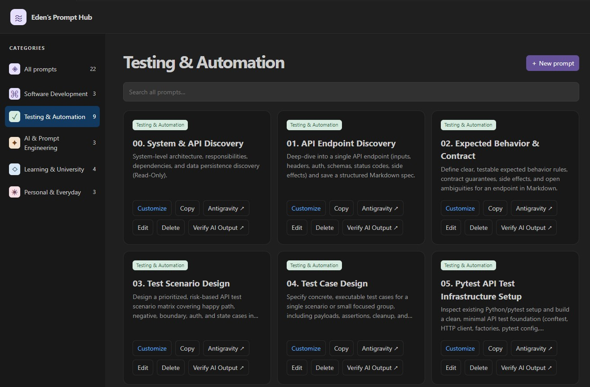
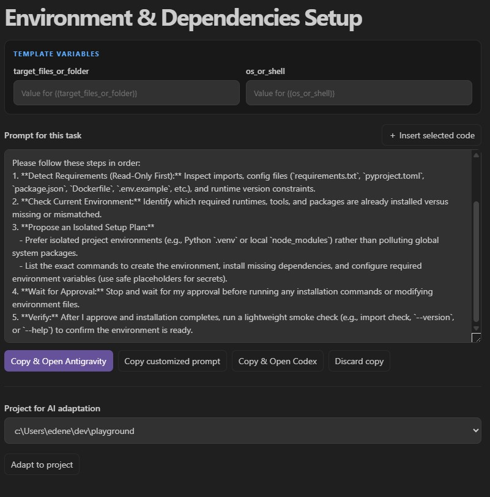

# Eden's Prompt Hub

A zero-dependency **Antigravity IDE** & **VS Code** extension for managing a personal, reusable prompt library — featuring temporary customization drafts, live `{{variable}}` templates, one-click selected code insertion, direct **Antigravity** and **Codex** integration, shared cross-IDE storage, and Markdown verification checklists.

---

## Screenshots

### Prompt Library Dashboard


### Customize View — Template Variables, Code Insertion & AI Integration


---

## Features

- **Unified Prompt Library (Sidebar & Full Dashboard)**
  - Browse all templates at once under **All prompts**, filter across 5 built-in categories (`Software Development`, `Testing & Automation`, `AI & Prompt Engineering`, `Learning & University`, `Personal & Everyday`), or search across titles, descriptions, content, and categories in real time.
  - Open any prompt in a distraction-free **Reader** view with one-click copy, Antigravity launch, customization, editing, and checklist verification.
- **Temporary Customization (`Customize`)**
  - Edit a temporary working copy of any prompt without modifying the saved template.
  - **Template Variables (`{{variable}}`):** Any `{{placeholder}}` in a template automatically generates fill-in inputs that update the draft live.
  - **Insert Selected Code (`＋ Insert selected code`):** Pulls the active editor's selected code snippet—formatted as a fenced Markdown block with file path and line numbers—directly into the draft.
- **Direct AI Tool Integration**
  - **Copy & Open Antigravity:** Copies the prompt to the clipboard and immediately focuses the Antigravity chat panel (`antigravity.panel.focus`).
  - **Copy & Open Codex:** Copies the prompt and opens the Codex sidebar (`openai.chatgpt`).
  - **Project-Aware AI Adaptation (`Adapt to project`):** Runs an ephemeral, read-only Codex CLI session (`--ephemeral --sandbox read-only`) against the currently open local workspace to propose a project-tailored rewrite without modifying files or executing commands.
- **Markdown Verification Checklists**
  - Attach verification criteria (one task per line) to any prompt template.
  - Open **Verify AI Output ↗** to track completion (`- [ ]` → `- [x]`) in a dedicated Markdown editor tab with persistent progress.
- **Shared Cross-IDE Storage**
  - Stores prompts and checklists in `~/.edens-prompt-hub` by default so **Antigravity IDE** and **VS Code** stay automatically synchronized.
  - Automatically performs a non-destructive one-time migration from legacy VS Code global storage when initializing an empty shared directory.

---

## Architecture & Engineering Highlights

- **Zero External Dependencies:** Built purely on native Node.js (`node:fs`, `node:crypto`, `node:child_process`) and the standard VS Code Extension & Webview APIs (`^1.85.0`)—no bundler or `node_modules` required.
- **Safe Atomic Persistence (`store.js`):** Each prompt is stored as an individual UUID-indexed JSON file with atomic writes (`.tmp` → rename) and exclusive `.lock` files (`wx`) to guard against concurrent edits and partial writes.
- **Security-First Webview:** Strict `Content-Security-Policy` (`default-src 'none'`) with a per-view cryptographic `nonce` (`crypto.randomBytes(20)`).
- **Reliable Editor Selection Tracking:** Captures active editor selections continuously via `onDidChangeTextEditorSelection`, allowing **Insert selected code** to work seamlessly from both the Activity Bar sidebar and the full Dashboard Webview panel.

---

## Installation

### Option 1: Install from Release `.vsix`
1. Download `edens-prompt-hub-1.2.0.vsix` from the **Releases** page.
2. In **Antigravity IDE** or **VS Code**, open **Extensions → `…` → Install from VSIX…** and select the downloaded file—or install via CLI:
   ```bash
   # Antigravity IDE
   antigravity-ide --install-extension edens-prompt-hub-1.2.0.vsix

   # VS Code
   code --install-extension edens-prompt-hub-1.2.0.vsix
   ```

### Option 2: Run from Source
1. Clone this repository and open it in **Antigravity IDE** or **VS Code**.
2. Press `F5` to launch an Extension Development Host window.
3. Click the layered **Eden's Prompt Hub** icon in the Activity Bar, or run **Eden's Prompt Hub: Open Dashboard** from the Command Palette.

---

## Configuration

| Setting | Type | Default | Description |
| :--- | :--- | :--- | :--- |
| `edenHub.storagePath` | `string` | `""` (`~/.edens-prompt-hub`) | Custom directory for storing prompt JSON files and Markdown checklists. Leave empty to use the shared `~/.edens-prompt-hub` folder across IDEs. |

---

## Project Structure

```text
edens-prompt-hub/
├── package.json     # Extension manifest, views, commands, and configuration
├── extension.js     # Extension host, shared storage, Antigravity/Codex & selection handlers
├── store.js         # Atomic JSON & Markdown checklist persistence with lockfile protection
├── adapt.js         # Ephemeral read-only Codex CLI wrapper for project-context adaptation
├── index.html       # Webview layout with strict CSP nonce placeholders
├── app.js           # Client-side state, template variable engine, and UI rendering
├── style.css        # VS Code theme-aware responsive styling
├── mark.svg         # Activity Bar icon
├── test.js          # Unit tests for storage, checklists, and non-destructive migration
└── LICENSE          # MIT License
```

---

## Testing

Run syntax verification and unit tests with Node.js (v18+):

```bash
npm test
```

---

## License

[MIT](./LICENSE)
